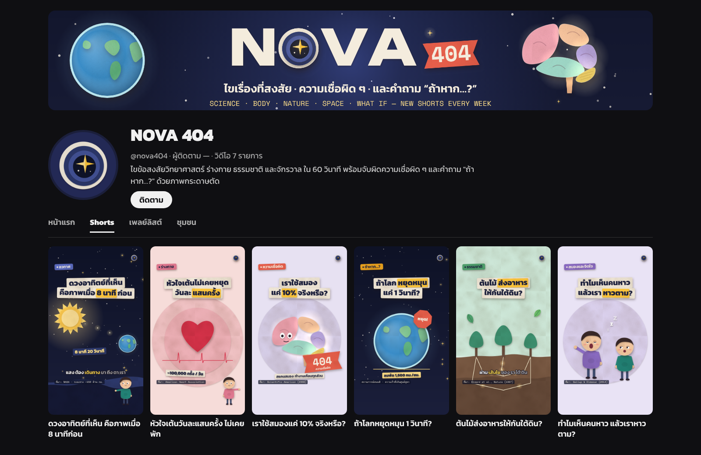

# NOVA 404 — Brand Identity

ชุดอัตลักษณ์ของช่อง **NOVA 404** สำหรับ YouTube Shorts แนว edutainment ที่ใช้ภาพกระดาษตัด (paper-cut) เนื้อหาครอบคลุมวิทยาศาสตร์ ธรรมชาติ จักรวาล ร่างกาย ความเชื่อผิด ๆ และคำถาม What If

> **ความรู้ที่หาไม่เจอ… เราหามาให้**



## เริ่มที่ไฟล์ไหน

| ต้องการ | ไฟล์ |
|---|---|
| คู่มือแบรนด์ฉบับเต็ม (15 หน้า) | `brand_guidelines/nova404_brand_guidelines.pdf` |
| คำอธิบายช่อง, tagline, keywords, กฎ title/description/hashtag | `brand_guidelines/channel_info.md` |
| โลโก้สำหรับอัปโหลดหรือใช้งาน | `logo/png/*.png` (โปร่งใส ความละเอียด 2×), `logo/*.svg` |
| รูปโปรไฟล์ YouTube | `logo/png/nova404_profile_800.png` |
| ภาพปกช่อง (banner) | `channel_art/nova404_channel_art_2560x1440.png` |
| สี | `color_palette/nova404_palette.{png,json,css}` |
| ฟอนต์ | `typography/TYPOGRAPHY.md`, `typography/fonts/` |
| ใช้ใน Shorts | `templates/nova_brand.js`, `templates/nova404_logo_sting.mp4`, `templates/nova404_end_card.mp4`, `templates/stills/` |
| ตัวอย่างภาพประกอบแต่ละหัวข้อ | `preview/samples/` |

## โครงสร้างโฟลเดอร์

```
brand_identity/
├── logo/              SVG: main light/dark, mono black/white, stacked light/dark, icon ×4, profile
│   ├── png/           PNG โปร่งใสของทุกไฟล์ด้านบน (2×)
│   └── concepts/      แนวคิด A · B · C (SVG + PNG)
├── channel_art/       2560×1440 + ภาพแสดง safe area
├── brand_guidelines/  PDF, guidelines.html (ต้นฉบับ), channel_info.md, img/ (ภาพย่อที่ใช้ใน PDF)
├── color_palette/     PNG · JSON · CSS
├── typography/        fonts/ (OFL) · sheet PNG · TYPOGRAPHY.md
├── templates/         nova_brand.js · logo sting / end card MP4 · stills/ (cover, kit, end card, thumbnail)
├── preview/           samples/ (6 หัวข้อ) · channel page mockup · logo concepts · legibility · sting strip
└── src/               make_logo.mjs · stage.html · scenes.js · mockup.html · render.mjs
```

## การเลือกโลโก้ (สรุป)

| แนวคิด | ข้อดี | ข้อเสีย | ผล |
|---|---|---|---|
| **A · Paper Portal** | วงกระดาษซ้อนกันเปิดเป็นหลุมมืด (404 = สิ่งที่ยังไม่รู้) แล้วมีดาว (NOVA) โผล่ออกมา จึงเล่าชื่อได้ครบ เป็นวงกลมที่เข้ากับโปรไฟล์ ใช้เป็นตัว O ได้ และโชว์เทคนิคกระดาษตัดชัด | ชั้นกระดาษกลืนกันเมื่อเล็กมาก จึงมีเวอร์ชัน mono 2 วงไว้ใช้แทน | **เลือก** |
| B · Folded Nova | อ่านง่ายที่ขนาดเล็ก | ดาว 4 แฉกดูทั่วไปและเสี่ยงเหมือนโลโก้ AI ส่วน 404 กลายเป็นแค่ข้อความ | ใช้เป็นดาวใน A |
| C · 404 Tag | สื่อเรื่องความเชื่อผิดได้ทันที | อ่านยากที่ 48 px โทนเหมือน error และขาดความลึกลับ | ใช้เป็นป้าย 404 ใน wordmark |

## สร้างไฟล์ใหม่ (รันจาก root ของ repo)

```bash
node brand_identity/src/make_logo.mjs                                   # SVG โลโก้ทั้งหมด
node brand_identity/src/render.mjs svg <in.svg> <out.png> 2             # SVG → PNG โปร่งใส
node brand_identity/src/render.mjs page "brand_identity/src/stage.html?scene=channelart&w=2560&h=1440" out.png 2560 1440
node brand_identity/src/render.mjs frames "brand_identity/src/stage.html?scene=sting&w=1080&h=1920" frames/ 1080 1920 3 30
node brand_identity/src/render.mjs pdf brand_identity/brand_guidelines/guidelines.html brand_identity/brand_guidelines/nova404_brand_guidelines.pdf
```

Scene ที่มีใน `src/scenes.js`:

- `channelart`, `channelart_guides`, `channelart_bare`
- `sample_space`, `sample_body`, `sample_myth`, `sample_whatif`, `sample_nature`, `sample_mind`
- `cover_template`, `thumb_16x9`, `sting`, `endcard`, `kit`

## ใช้ใน Short

ใน `shorts_<slug>.html` ให้โหลด `brand_identity/templates/nova_brand.js` ต่อจาก `src/shorts/paper.js` แล้วเรียกฟังก์ชันในช็อตได้เลย:

- `novaChip('myth', 72, 238, { k })`
- `novaHook(['เราใช้สมอง', 'แค่ [[10%]] จริงหรือ?'], 540, 420, { k })`
- `novaSource(...)`
- `novaMyth(...)`
- `novaSting(t)` และ `novaEnd(t)` สำหรับช็อตปิด

ทุกฟังก์ชันเป็น pure function ของเวลา เหมือนส่วนอื่นของ engine
