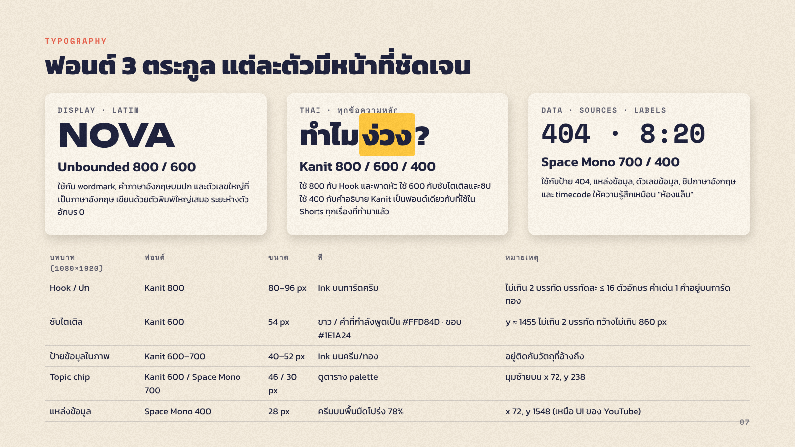

# NOVA 404 — Typography

| ตระกูล | น้ำหนักที่ใช้ | หน้าที่ | ไฟล์ |
|---|---|---|---|
| **Unbounded** | 800, 600 | wordmark "NOVA", คำภาษาอังกฤษบนปกและ banner (ตัวพิมพ์ใหญ่เสมอ) | `fonts/unbounded-800.ttf`, `unbounded-600.ttf` |
| **Kanit** | 800, 600, 400 | ข้อความภาษาไทยทั้งหมด: Hook (800), ซับไตเติลและชิป (600), เนื้อความ (400) | `fonts/kanit-*.ttf` |
| **Space Mono** | 700, 400 | ป้าย 404, ตัวเลขข้อมูล, แหล่งข้อมูล, ชิปภาษาอังกฤษ | `fonts/spacemono-*.ttf` |

ทั้งสามฟอนต์ใช้สัญญาอนุญาต SIL Open Font License 1.1 ใช้ในงานเชิงพาณิชย์และฝังในวิดีโอได้

## ขนาดบนเฟรม Shorts 1080×1920

| บทบาท | ฟอนต์ | ขนาด | สี | กฎ |
|---|---|---|---|---|
| Hook / พาดหัว | Kanit 800 | 80–96 px | Ink `#1B1F3B` บนการ์ดครีม | ไม่เกิน 2 บรรทัด บรรทัดละไม่เกินประมาณ 16 ตัวอักษร มีคำเด่น 1 คำบนการ์ดทอง |
| ซับไตเติล | Kanit 600 | 54 px | ขาว · คำที่กำลังพูด `#FFD84D` · ขอบ `#1E1A24` | y ≈ 1455 กว้างไม่เกิน 860 px (ตาม `subs_th.js`) |
| ป้ายข้อมูลในภาพ | Kanit 600–700 | 40–52 px | Ink บนครีมหรือทอง | วางติดกับวัตถุที่อ้างถึง |
| Topic chip | Kanit 600 / Space Mono 700 | 46 / 30 px | ตามตารางสีหัวข้อ | x 72, y 238 |
| แหล่งข้อมูล | Space Mono 400 | 28 px | ครีมบนพื้นมืดโปร่ง 78% | x 72, y 1548 |
| End card | Kanit 600 / 400 | 52 / 38 px | ครีม / Mist | — |

## กฎ

- ห้ามใช้ฟอนต์อื่นนอกจากสามตระกูลนี้ในงานของช่อง
- ภาษาไทยไม่ใช้ letter-spacing ส่วน Space Mono ที่เป็นตัวพิมพ์ใหญ่ใช้ letter-spacing ได้ 0.1–0.18 em
- ห้ามใช้ตัวเอียงหรือขีดเส้นใต้ ถ้าต้องการเน้นให้ใช้การ์ดทอง
- ตัวเลขในประโยคภาษาไทยใช้เลขอารบิก (1, 2, 3) และใส่จุลภาคเมื่อมีหลักพัน
