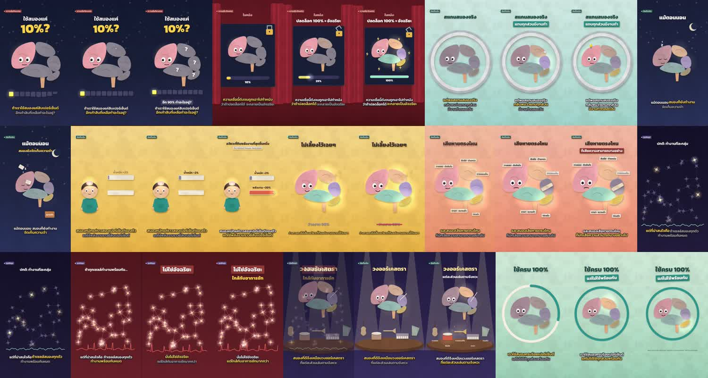

# QC Report — เราใช้สมองแค่ 10% จริงหรือ?

ไฟล์ที่ตรวจ:

- `out/shorts/brain10/brain10_shorts.mp4` (ไฟล์หลัก 34 MB)
- `out/shorts/brain10/brain10_shorts_720p.mp4` (5.1 MB สำหรับมือถือ)

## สเปก (ffprobe)

| รายการ | เป้าหมาย | ผล | สถานะ |
|---|---|---|---|
| ความยาว | 30–40 s | 39.83 s | ✅ |
| ความละเอียด | 1080×1920 (9:16) | 1080×1920, h264 yuv420p | ✅ |
| เฟรมเรต | 30 fps | 30/1, 1,195 เฟรม | ✅ |
| รูปแบบ | MP4 | MP4 (faststart), AAC 48 kHz stereo | ✅ |
| ความดัง | ประมาณ −14 LUFS | ไฟล์หลัก −14.1 LUFS, peak −2.6 dBFS; ไฟล์ 720p −14.2 LUFS, peak −2.1 dBFS | ✅ |

## ภาพ

| ตรวจ | วิธี | ผล |
|---|---|---|
| **ความปลอดภัยต่อผู้มีภาวะชักจากแสง** | นับจำนวนครั้งที่ความสว่างทั้งจอเปลี่ยนขึ้นลงแรงภายในทุกช่วง 1 วินาที | ✅ แก้แล้ว (ดูหัวข้อถัดไป) หลังแก้ เปลี่ยนแรงสุดไม่เกิน 1 ครั้งต่อวินาที (เกณฑ์ ≤ 3) |
| ส่วนสำคัญไม่หลุดเฟรม | contact sheet และเฟรมเต็มขนาด | ✅ แก้แล้ว 3 จุด: สมองใน Hook ถูกตัดขอบตอนกล้องซูม, ป้ายกลีบสมองชนการ์ดหัวข้อตอนกล้องเลื่อนเข้า, เครื่องดนตรีเล็กเกินจนดูไม่ออก |
| ไม่มีภาพกระตุก | วัดความต่างระหว่างเฟรมทั้ง 1,195 เฟรม | ✅ จุดที่ภาพเปลี่ยนแรงเหลือเพียง 3 จุด ซึ่งเป็น dissolve ระหว่างฉาก (7.9 s, 14.9 s, 25.5 s) ไม่มีเฟรมดำ |
| ไม่มีช่วงว่าง | หาช่วงที่ภาพแทบไม่ขยับ | ✅ ช่วงนิ่งที่ยาวที่สุดคือ 1.4 s ในฉาก 2% / 20% ระหว่างรอแถบพลังงาน (กล้องยังค่อยๆ เลื่อนเข้า) |
| ตัวละครหรือวัตถุไม่เปลี่ยนรูป | กลีบสมองเป็นรูปทรงตายตัว | ✅ เปลี่ยนเฉพาะสี แสง ตา และปาก |

### ปัญหาด้านความปลอดภัยที่พบและแก้

เรนเดอร์รอบแรก ฉากหักมุมเรื่องอาการชัก (28–31.8 s) มีแสงขาวกะพริบทั้งจอราว 6 ครั้งต่อวินาที ความสว่างเปลี่ยนแรงทุกเฟรม การกะพริบในช่วง 3–60 Hz อาจกระตุ้นอาการชักในผู้ที่มีภาวะชักจากแสง (photosensitive epilepsy) และแนวทางด้านการออกอากาศกำหนดไว้ไม่เกิน 3 ครั้งต่อวินาที

แก้โดยเปลี่ยนเป็นสีแดงทับจอแบบคงที่ ยังคงการสั่นของกล้องและเส้นคลื่นสมองที่พุ่งเป็นยอดแหลมไว้ แล้วเรนเดอร์ฉากนั้นใหม่ และเพิ่มคอมเมนต์ในโค้ดกำกับไว้ว่าห้ามใช้ strobe

## เสียง

| ตรวจ | วิธี | ผล |
|---|---|---|
| บรรยายตรงบท ไม่มีคำซ้ำหรือคำขาด | `shorts_checkcuts.py` | ✅ ทั้ง 11 บรรทัดตรงบทตั้งแต่ครั้งแรก |
| เสียงบรรยายเหนือดนตรีและ SFX | เทียบพลังงานในย่านเสียงพูด | ✅ ทุกบรรทัดสูงกว่า 8.6–17.4 dB (เกณฑ์ ≥ 8 dB) รอบแรกบรรทัดสุดท้ายได้แค่ 6.0 dB จึงลดเสียงกวาดของวงแหวนลงและเลื่อน chime ไปหลังคำสุดท้าย |
| เสียงตรงกับภาพ | ภาพและ SFX ใช้ไฟล์เวลาวลีชุดเดียวกัน (`phrases.js`) | ✅ |
| ฟังด้วยหู | — | ⚠️ ยังไม่ได้ฟัง เพราะ Claude ฟังเสียงไม่ได้ ควรมีคนฟังก่อนเผยแพร่ |

## เนื้อหา

| ตรวจ | ผล |
|---|---|
| แยกความเชื่อกับข้อเท็จจริง | ✅ ใช้ป้าย "ความเชื่อที่พบบ่อย", "ความเชื่อ (ในหนัง)", "ข้อเท็จจริง" และ "จุดหักมุม" |
| แถบ 2% กับ 20% | ✅ วาดที่สเกลเดียวกัน อัตราส่วน 1:10 ถูกต้อง |
| อาการชัก | ✅ ใช้คำว่า "ใกล้กับ" ไม่ได้บอกว่าเป็นสิ่งเดียวกัน และภาพไม่มีแสงกะพริบ |
