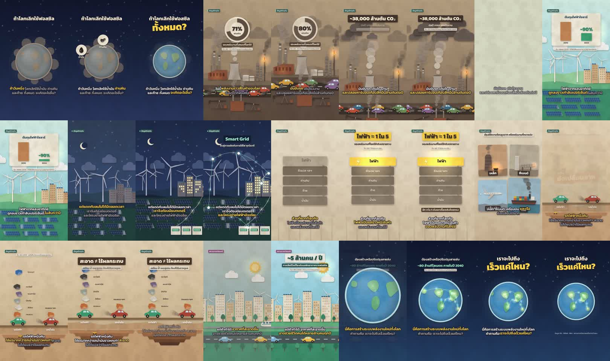

# QC Report — ถ้าโลกเปลี่ยนไปใช้พลังงานสะอาดทั้งหมด?

ไฟล์ที่ตรวจ: `out/shorts/clean-energy_shorts.mp4` (ไฟล์หลัก) และ `out/shorts/clean-energy_shorts_720p.mp4` (สำเนาสำหรับดูบนมือถือ)

## สเปกไฟล์ (ffprobe)

| รายการ | เป้าหมาย | ผล | สถานะ |
|---|---|---|---|
| ความละเอียด | 1080×1920 (9:16) | 1080×1920, h264 yuv420p | ✅ |
| เฟรมเรต | 30 fps | 30/1, 1,197 เฟรม | ✅ |
| ความยาว | 35–40 s | 39.90 s | ✅ |
| เสียง | มีเสียงบรรยาย, BGM และ SFX | AAC 48 kHz stereo, 192 kbps | ✅ |
| ความดัง | ประมาณ −14 LUFS สำหรับ YouTube | −14.0 LUFS integrated, peak −0.4 dBFS หลังแปลงเป็น AAC (ใน WAV ก่อนแปลงอยู่ที่ −1.5 dBTP) | ✅ |

## ภาพ

| ตรวจ | วิธีตรวจ | ผล |
|---|---|---|
| คุณภาพทุกฉากสม่ำเสมอ | ดู contact sheet ทั้งเรื่อง (1 เฟรมทุก 1.5 s) และเปิดดูเฟรมเต็มขนาด | ✅ ทุกฉากใช้ชุดเครื่องมือ Paper Cut และ grain เดียวกัน เงาเข้มขึ้นตามความสูงของชั้น |
| รูปทรงอุปกรณ์สมเหตุสมผล | ดูเฟรมเต็มขนาด | ✅ กังหันมี 3 ใบบนเสาเรียว, หอหล่อเย็นเป็นทรงเอว, ปล่องมีลายแถบ, แผงโซลาร์เอียงบนขาพร้อมเส้นเซลล์, แบตเตอรี่เป็นตู้คอนเทนเนอร์มีระดับประจุ, ปั๊มน้ำมันมีหัวม้าและแขนถ่วง, เสาส่งเป็นโครงถัก |
| ไม่มีวัตถุผิดรูปหรือเปลี่ยนรูประหว่าง animation | ทุกวัตถุเป็นฟังก์ชันของเวลา ไม่มี morph และดู strip ทุกเฟรมของ hook, wipe และแผ่นที่ตกลงมา | ✅ |
| ไม่มีเฟรมว่างหรือภาพกระตุก | `blackdetect` และวัดความต่างระหว่างเฟรมทั้ง 1,197 เฟรม (median 0.69) | ✅ ไม่พบเฟรมดำ จุดที่ภาพเปลี่ยนแรงมี 3 จุดและตั้งใจทั้งหมด: แสงวาบตอนตัดสาย (2.77 s), กระดาษ wipe (11.0–11.3 s), แผ่นกระดาษตกลงมา (19.1–19.5 s) ทั้ง 3 จุดเคลื่อนไหวต่อเนื่องเมื่อดูใน strip |
| ข้อความอ่านง่าย | ดูเฟรมเต็มขนาด | ✅ ซับไตเติล Kanit 54 px มีขอบหมึกหนาและเงา ตัวเลขหลัก 72–150 px บนการ์ดกระดาษ อยู่ในพื้นที่ปลอดภัยของ Shorts (ไม่อยู่ในแถบล่าง 300 px หรือใต้ปุ่มด้านขวา) ป้าย "ที่มา" 26 px อ่านได้บนจอมือถือแต่ตัวเล็ก ตั้งใจให้เป็นข้อมูลประกอบ |
| ข้อความไม่ทับกัน | ดูเฟรมช่วงที่ข้อความเปลี่ยน | ✅ แก้แล้ว: ไอคอนถ่านหินเคยทับชื่อเรื่องใน hook และข้อความแบตเตอรี่เคยทับกับ Smart Grid |

## เสียง

| ตรวจ | วิธีตรวจ | ผล |
|---|---|---|
| บรรยายตรงบท | ถอดเสียงจาก mix สุดท้ายด้วย Gemini 3.5 Flash | ✅ ทั้ง 10 บรรทัดตรงบท ⚠️ ข้อสังเกต: บรรทัด n02 คำว่า "ราว" ออกเสียงสั้นจนเครื่องถอดเป็น "เรา" แต่ซับไตเติลแสดง "ราวสี่ในห้า" ถูกต้อง |
| เสียงบรรยายเหนือดนตรี | เทียบพลังงานในย่านเสียงพูด (มากกว่า 250 Hz) ระหว่างเสียงพูดกับดนตรีและ SFX ที่อยู่ข้างใต้ | ✅ ทุกบรรทัดสูงกว่า 11.6–22.0 dB (เกณฑ์ของโปรเจกต์เดิมคือ ≥ 8 dB) ดนตรีถูก duck ใต้เสียงพูดด้วย sidechain |
| เสียงตรงกับภาพ | SFX และภาพอ่านเวลาวลีจากชุดเดียวกัน (`phrases.js`) | ✅ ดูจาก spectrogram ว่าดนตรี 4 ช่วงตรงกับจุดตัดฉาก และ SFX ตรงจังหวะ (ตัดสาย, แผงกาง, แบตเตอรี่, แผ่นตก, ตราประทับ, แร่ตก) |
| ฟังด้วยหู | — | ⚠️ ยังไม่ได้ฟัง Claude ฟังเสียงไม่ได้ การตรวจทั้งหมดใช้ spectrogram, การวัดค่า และการถอดเสียง ควรมีคนฟังระดับเสียงและโทนดนตรีอีกครั้งก่อนเผยแพร่ |

## ความถูกต้องของเนื้อหา

| ตรวจ | ผล |
|---|---|
| ตัวเลขทุกตัวมีที่มาจาก IEA, IRENA หรือ BMJ (ดูตารางใน `SCRIPT.md`) | ✅ ใช้คำว่า "ราว", "เกือบ" หรือ "~" |
| ไม่ฟันธงว่าค่าไฟจะถูกลง หรือพลังงานจะฟรี | ✅ พูดถึงต้นทุนการผลิตไฟจากโซลาร์ (LCOE) ที่ลดลงในอดีตเท่านั้น |
| ไม่บอกว่าแบตเตอรี่แก้ได้ทุกอย่าง | ✅ มีข้อความ "สำรองไฟได้หลายชั่วโมง · ยังไม่ใช่ข้ามฤดูกาล" |
| ไม่บอกว่าการเปลี่ยนผ่านทำได้ทันที | ✅ มีทั้งส่วนที่ยาก, อุตสาหกรรมที่ยังเปลี่ยนยาก, แร่ และสายส่ง 80 ล้านกม. ภายในปี 2040 ตอนจบเป็นคำถามปลายเปิด |
| พลังงานสะอาดไม่ได้ไร้ผลกระทบ | ✅ มีฉากเหมืองกับข้อความ "สะอาด ≠ ไร้ผลกระทบ" |
| ไม่สลับคำว่าสะอาดกับหมุนเวียน | ✅ ใช้คำว่า "พลังงานสะอาด" อย่างเดียว |
| แยกข้อเท็จจริงกับสถานการณ์สมมติ | ✅ มีป้าย "ข้อมูลปัจจุบัน" กับ "สถานการณ์สมมติ" และท้ายคลิประบุว่าภาพอนาคตเป็นการจำลอง |
| ตัวเลขผู้เสียชีวิต | ✅ ระบุว่าเป็น "ค่าประมาณจากแบบจำลอง" และบรรยายใช้คำว่า "อาจช่วยชีวิต" |

## ข้อจำกัดและสิ่งที่ปรับจากแผนเดิม

| เรื่อง | รายละเอียด |
|---|---|
| โควตา TTS | โควตารายวันของ Gemini 3.8 Flash TTS หมด จึงใช้ Gemini 2.5 Flash TTS แทน (เสียง Puck) สร้างเทคเดียวทั้งบท แล้วเร่งเป็น 1.25 เท่าเพื่อให้ความยาวอยู่ในช่วง 35–40 s |
| ดนตรี | Lyria ไม่มีโควตาใน free tier ดนตรีจึงสังเคราะห์ด้วยโค้ดทั้งหมด (`scripts/shorts_audio.mjs`) |
| เวลาวลี | การจัดเวลาวลีอัตโนมัติด้วย Gemini คลาดไปถึง 1.5 s จึงตั้งเวลาเองจาก envelope ของเสียงและจำนวนพยางค์ |
