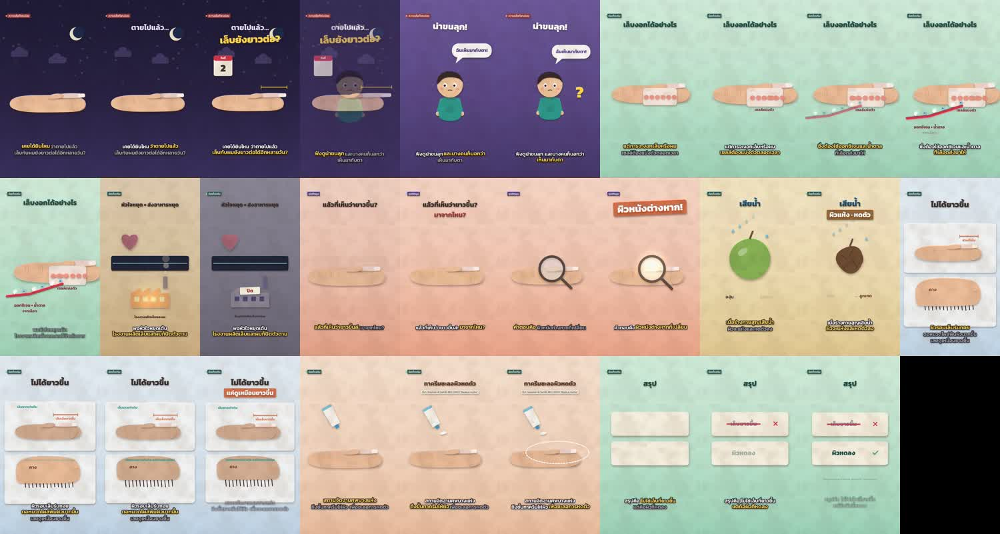

# QC Report — เล็บและผมยังยาวหลังเสียชีวิตจริงไหม?

ไฟล์ที่ตรวจ:
- `out/shorts/nails/nails_shorts.mp4` (ไฟล์หลัก 29 MB)
- `out/shorts/nails/nails_shorts_720p.mp4` (4.3 MB สำหรับมือถือ)

## สเปก (ffprobe)

| รายการ | เป้าหมาย | ผล | สถานะ |
|---|---|---|---|
| ความยาว | 30–40 s | 39.20 s | ✅ |
| ความละเอียด | 1080×1920 (9:16) | 1080×1920, h264 yuv420p | ✅ |
| เฟรมเรต | 30 fps | 30/1, 1,176 เฟรม | ✅ |
| รูปแบบ | MP4 | MP4 (faststart), AAC 48 kHz stereo | ✅ |
| ความดัง | ประมาณ −14 LUFS | −14.1 LUFS, peak −2.8 dBFS (ไฟล์ 720p: −14.2 LUFS, −2.2 dBFS) | ✅ |

## ภาพ

| ตรวจ | วิธี | ผล |
|---|---|---|
| ความปลอดภัยด้านแสงกะพริบ | นับจำนวนครั้งที่ความสว่างทั้งจอเปลี่ยนขึ้นลงแรงภายใน 1 วินาที | ✅ 0 ครั้ง |
| ไม่มีภาพกระตุก | วัดความต่างระหว่างเฟรมทั้ง 1,176 เฟรม | ✅ ไม่พบจุดที่ภาพเปลี่ยนแรงเลย และไม่มีเฟรมดำ |
| ไม่มีช่วงว่าง | หาช่วงที่ภาพแทบไม่ขยับ | ✅ ช่วงนิ่งที่ยาวที่สุดคือ 1.17 s |
| ภาพอ่านออก | ดูเฟรมเต็มขนาด | ✅ แก้แล้ว 2 จุด: นิ้วรอบแรกดูเหมือนไส้กรอก (เล็บบาง แผ่นผิวด้านบนยาวและเข้มเกินไป) จึงวาดใหม่ให้มีพระจันทร์เล็บ ขอบผิวรอบเล็บ และรอยข้อนิ้ว ส่วนตอหนวดเดิมชี้ขึ้นไปซ่อนในผิว จึงแก้ให้ชี้ลงออกจากผิว |
| วัตถุไม่เปลี่ยนรูปโดยไม่ตั้งใจ | เล็บมีความยาวคงที่ (`nailLen`) และรากกับความยาวของหนวดคงที่ | ✅ ขยับแค่ผิว ซึ่งเป็นสิ่งที่เรื่องต้องการแสดง องุ่นที่กลายเป็นลูกเกดเป็นการเปลี่ยนรูปที่ตั้งใจ |
| ความเหมาะสมของภาพ | — | ✅ ไม่มีภาพศพหรือภาพน่ากลัว ใช้ภาพเปรียบเทียบ (โรงงาน, องุ่น, ECG) |

## เสียง

| ตรวจ | วิธี | ผล |
|---|---|---|
| บรรยายตรงบท | `shorts_checkcuts.py` | ✅ ทั้ง 11 บรรทัดตรงบท ระหว่างทำจับจุดตัดผิดได้ 2 จุดแล้วแก้ คือ "พอหัวใจหยุดเต้น" ที่หลุดไปอยู่บรรทัด 4 (จุดตัดจริงคือช่วงหายใจ 13.70–13.89 s) และ "หด\|ตัว" ที่ถูกตัดแยก |
| เสียงบรรยายเหนือดนตรีและ SFX | เทียบพลังงานในย่านเสียงพูด | ✅ ทุกบรรทัดสูงกว่า 12.4–22.2 dB (เกณฑ์ ≥ 8 dB) |
| เสียงตรงกับภาพ | ใช้เวลาของวลีจาก `phrases.js` ชุดเดียวกัน | ✅ |
| ฟังด้วยหู | — | ⚠️ ยังไม่ได้ฟัง Claude ฟังเสียงไม่ได้ ควรมีคนฟังก่อนเผยแพร่ |

## เนื้อหา

| ตรวจ | ผล |
|---|---|
| แยกความเชื่อกับข้อเท็จจริง | ✅ มีป้าย "ความเชื่อที่พบบ่อย", "ข้อเท็จจริง" และ "จุดหักมุม" |
| แหล่งข้อมูล | ✅ BMJ 2007 แสดงบนจอ และอยู่ในตารางของ `SCRIPT.md` |
| ข้อสังเกตเล็กน้อย | ⚠️ การ์ดสรุปว่างอยู่ราว 0.8 s ก่อนข้อความแรกเด้งขึ้น ไม่ได้แก้ |
