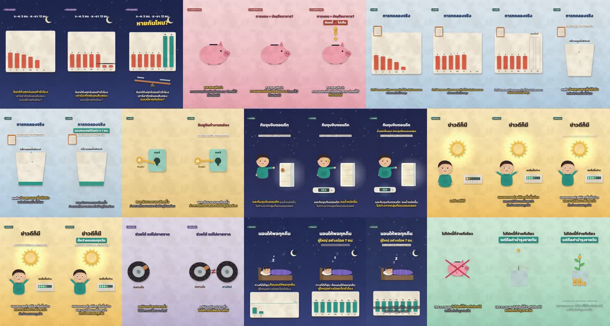

# QC Report — นอนชดเชยวันหยุดทดแทนการอดนอนได้ไหม?

ไฟล์ที่ตรวจ:
- `out/shorts/sleepdebt/sleepdebt_shorts.mp4` (ไฟล์หลัก 32 MB)
- `out/shorts/sleepdebt/sleepdebt_shorts_720p.mp4` (4.7 MB สำหรับดูบนมือถือ)

## สเปก (ffprobe)

| รายการ | เป้าหมาย | ผล | สถานะ |
|---|---|---|---|
| ความยาว | 30–40 s | 39.77 s | ✅ |
| ความละเอียด | 1080×1920 (9:16) | 1080×1920, h264 yuv420p | ✅ |
| เฟรมเรต | 30 fps | 30/1, 1,193 เฟรม | ✅ |
| รูปแบบ | MP4 | MP4 (faststart), AAC 48 kHz stereo | ✅ |
| ความดัง | ประมาณ −14 LUFS | ไฟล์หลัก −14.3 LUFS, peak −2.9 dBFS / ไฟล์ 720p −14.4 LUFS, peak −2.6 dBFS | ✅ |

## ภาพ

| ตรวจ | วิธี | ผล |
|---|---|---|
| ความปลอดภัยด้านแสงกะพริบ | นับจำนวนครั้งที่ความสว่างทั้งจอเปลี่ยนแรงต่อวินาที | ✅ สูงสุด 1 ครั้งต่อวินาที (เกณฑ์ ≤ 3) |
| ไม่มีภาพกระตุก | วัดความต่างระหว่างเฟรมทุกคู่ | ✅ จุดที่ภาพเปลี่ยนแรงมี 2 จุด และเป็นการเปลี่ยนที่ตั้งใจทั้งคู่: กลางวันเป็นกลางคืนในฉากกินดึก (18.9 s) และการจางภาพเข้าฉากอรุณ (22.8 s) ไม่มีเฟรมดำ |
| ไม่มีช่วงว่าง | หาช่วงที่ภาพแทบไม่ขยับ | ✅ ช่วงนิ่งที่ยาวที่สุดคือ 1.2 s |
| ส่วนสำคัญไม่หลุดหรือทับกัน | ดูเฟรมเต็มขนาด | ✅ แก้แล้ว 5 จุด: กราฟมีเลข "0.01" ในคอลัมน์วันหยุดที่ว่าง, ป้าย "+1 ชม." ซ้ำทับการ์ดหัวข้อ, ซับไตเติลทับตาชั่ง, ซับไตเติลทับกราฟ 7 คืน, ดวงจันทร์บังคำว่า "7 ชม." |
| ภาพตรงกับข้อมูล | ตรวจเทียบกับแหล่งข้อมูล | ✅ แก้แล้ว: แบบแรกวาดแท่งวันหยุดสูงราว 8 ชม. ซึ่งขัดกับข้อค้นพบ "นอนเพิ่มแค่ราว 1 ชม." และเป็นตัวเลขที่ไม่มีแหล่งอ้างอิง จึงเปลี่ยนเป็นภาพ "ถังหนี้การนอน" ที่เติมได้แค่ก้นถัง |
| วัตถุไม่เปลี่ยนรูป | ตรวจรูปทรงของวัตถุตลอดคลิป | ✅ ทุกชิ้นมีรูปทรงตายตัว |

## เสียง

| ตรวจ | วิธี | ผล |
|---|---|---|
| บรรยายตรงบท | `shorts_checkcuts.py` | ✅ ทั้ง 11 บรรทัดตรงบทตั้งแต่รอบแรก |
| เสียงบรรยายดังกว่าดนตรีและ SFX | เทียบพลังงานในย่านเสียงพูด | ✅ ทุกบรรทัดดังกว่า 14.6–19.9 dB รอบแรกบรรทัด 7 "แต่ข่าวดีก็มี" ได้แค่ 4.9 dB เพราะเสียงกระดิ่งตอนพระอาทิตย์ขึ้นทับบรรทัดสั้นนี้พอดี จึงเลื่อนเสียงกระดิ่งไปหลังบรรทัด |
| เสียงตรงกับภาพ | ใช้ไฟล์ `phrases.js` ชุดเดียวกัน | ✅ |
| ฟังด้วยหู | — | ⚠️ ยังไม่ได้ฟัง เพราะ Claude ฟังเสียงไม่ได้ ควรมีคนฟังก่อนเผยแพร่ |

## เนื้อหา

| ตรวจ | ผล |
|---|---|
| แยกความเชื่อ งานวิจัย และคำแนะนำ | ✅ ใช้ป้าย "ความเชื่อที่พบบ่อย", "งานวิจัย", "ข้อเท็จจริง", "เปรียบเทียบ" และ "คำแนะนำ" |
| หลักฐานเชิงสำรวจ | ✅ ระบุว่าเป็นงานวิจัยเชิงสำรวจ และบรรยายใช้คำว่า "บางชิ้น" |
| ข้อจำกัดของแหล่งข้อมูล | ⚠️ Åkerstedt 2018 อ้างอิงจากรายงานรอง ยังไม่ได้อ่านต้นฉบับ (ระบุไว้ใน `SCRIPT.md`) |
