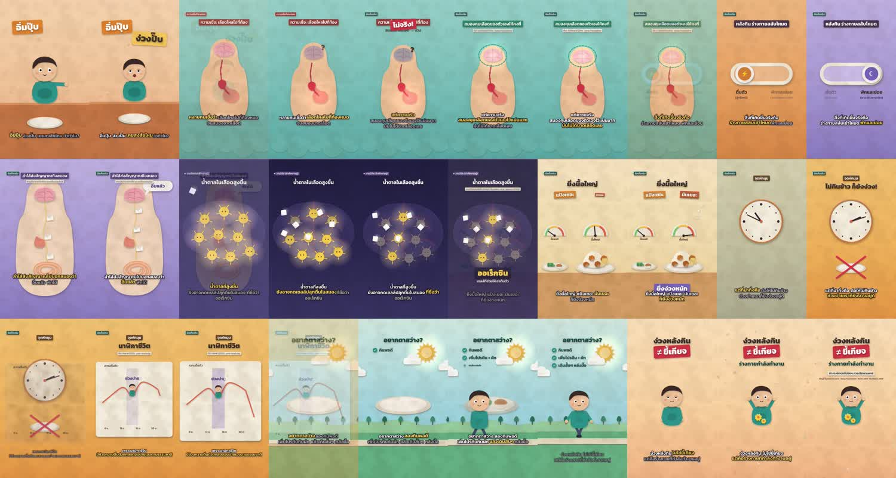

# QC Report — ทำไมเราถึงรู้สึกง่วงหลังจากกินอาหาร?

ไฟล์ที่ตรวจ: `out/shorts/sleepy/sleepy_shorts.mp4` (ไฟล์หลัก 43 MB) และ `sleepy_shorts_720p.mp4` (5.4 MB สำหรับดูบนมือถือ)

## สเปก (ffprobe)

| รายการ | เป้าหมาย | ผล | สถานะ |
|---|---|---|---|
| ความยาว | 30–40 s | 39.90 s | ✅ |
| ความละเอียด | 1080×1920 (9:16) | 1080×1920, h264 yuv420p | ✅ |
| เฟรมเรต | 30 fps | 30/1, 1,197 เฟรม | ✅ |
| รูปแบบ | MP4 | MP4 (faststart), AAC 48 kHz stereo | ✅ |
| ความดัง | ประมาณ −14 LUFS | −14.5 LUFS, peak −2.3 dBFS (ไฟล์ 720p: −14.6 LUFS, peak −2.2 dBFS) | ✅ |

## ภาพ

| ตรวจ | วิธี | ผล |
|---|---|---|
| ส่วนสำคัญไม่หลุดเฟรม | contact sheet ทั้งเรื่องและเฟรมเต็มขนาด | ✅ แก้แล้ว 4 จุด: จานและตัวละครใน Hook ถูกซับทับ, ตัวละครเล็กในช็อต 3 ถูกซับทับ, ซับช็อตออเร็กซินต่ำเกินจนเข้าโซน UI ของ Shorts, วลียาวในบรรทัด n09 ล้นขอบจอ (แก้โดยให้ `subs_th.js` ย่อทั้งบรรทัด) |
| ไม่มีภาพกระตุก | วัดความต่างระหว่างเฟรมทั้ง 1,197 เฟรม | ✅ ไม่มีเฟรมดำ จุดเดียวที่ภาพเปลี่ยนแรงคือ dissolve จากฉากสมองสีเข้มไปฉากอาหารสีสว่าง (20.7 s) ซึ่งเป็นการจางต่อเนื่องเมื่อดูใน strip ทีละเฟรม |
| ไม่มีช่วงนิ่งโดยไม่จำเป็น | หาช่วงที่ภาพแทบไม่ขยับ | ✅ เจอแล้วแก้ 3 จุด แล้วเรนเดอร์ใหม่: กราฟนาฬิกาชีวิตนิ่ง 2.3 s, กล้องช็อต 2 หยุดก่อนจบช็อต, กล้องช็อต 4 กระตุกตอนคำว่า "ออเร็กซิน" ทั้งสามเกิดจากบั๊กเดียวกัน คือใช้ความยาวช็อตเป็นเวลาจริง ตอนนี้ช่วงนิ่งที่ยาวที่สุดคือ 1.2 s บนการ์ดปิดหลังจบบรรยาย ซึ่งยังมีเศษกระดาษร่วงอยู่ |
| ตัวละครหรือวัตถุไม่เปลี่ยนรูป | ทุกชิ้นของตัวละครเป็นรูปทรงตายตัว ขยับได้แค่ตำแหน่ง มุม และขนาด | ✅ เปลือกตา พุง แขน และขาขยับตามค่าควบคุม ไม่มีการ morph |
| ข้อความอ่านง่าย | ดูเฟรมเต็มขนาด | ✅ หัวข้อ 58–140 px บนการ์ดกระดาษ ซับ Kanit 54 px มีขอบหมึก ป้าย "ที่มา" 26 px เป็นข้อมูลประกอบ |
| ความสม่ำเสมอของภาพ | contact sheet | ✅ ทั้ง 8 ช็อตใช้ชุดเครื่องมือกระดาษ เงา และ grain เดียวกัน แต่ละฉากมีสีของตัวเอง |

## เสียง

| ตรวจ | วิธี | ผล |
|---|---|---|
| บรรยายตรงบท ไม่มีคำซ้ำหรือคำขาด | ถอดเสียงทีละบรรทัด (n01–n08) และถอดเสียงบรรยายที่วางแล้วทั้งเรื่อง | ✅ ทั้ง 11 บรรทัดตรงบททุกคำ |
| จุดตัดบรรทัดไม่ตัดกลางคำ | วัดระดับเสียงต้นและท้ายของทุกบรรทัด และดู envelope ทุกจุดตัด | ✅ จุดตัด n04/n05 อยู่ในช่วงหายใจ 0.3 s (13.66–13.97 s ในเทค) |
| เสียงบรรยายเหนือดนตรีและ SFX | เทียบพลังงานในย่านเสียงพูด | ✅ ทุกบรรทัดสูงกว่า 9.8–25.0 dB (เกณฑ์ของโปรเจกต์คือ ≥ 8 dB) |
| เสียงตรงกับภาพ | ภาพและ SFX อ่านเวลาวลีจากชุดเดียวกัน (`phrases.js`) | ✅ ป้ายทุกใบ, ตราประทับ "ไม่จริง!", สวิตช์, ก้อนน้ำตาล, หน้าปัด, ภาพกากบาท, เช็กลิสต์ และป้าย "≠ ขี้เกียจ" ขึ้นตรงคำ |
| ฟังด้วยหู | — | ⚠️ ยังไม่ได้ฟัง Claude ฟังเสียงไม่ได้ ควรมีคนฟังระดับเสียงและโทนดนตรีก่อนเผยแพร่ |

## เนื้อหา

| ตรวจ | ผล |
|---|---|
| ความเชื่อผิด (เลือดไหลไปท้อง) | ✅ ติดป้าย "ความเชื่อที่พบบ่อย" และหักด้วยข้อเท็จจริงพร้อมที่มา |
| หลักฐานจากสัตว์ทดลอง (ออเร็กซิน) | ✅ ใช้คำว่า "อาจ" ติดป้าย "งานวิจัย (ยังศึกษาอยู่)" และภาพให้เซลล์ดับเพียงบางส่วน |
| คำแนะนำ | ✅ เป็นคำแนะนำทั่วไป ใช้คำว่า "ลอง" และมีคำเตือน "ถ้าง่วงผิดปกติบ่อยๆ ควรปรึกษาแพทย์" |
| แหล่งข้อมูล | ✅ ดูตารางใน `SCRIPT.md` |
