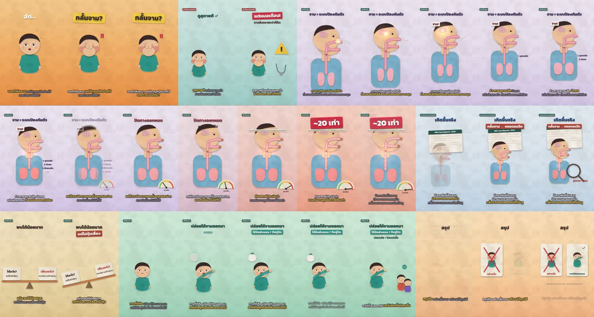

# QC Report — ทำไมเราไม่ควรกลั้นจาม?

ไฟล์ที่ตรวจ: `out/shorts/sneeze/sneeze_shorts.mp4` (ไฟล์หลัก 35 MB) และ `sneeze_shorts_720p.mp4` (4.8 MB สำหรับมือถือ)

## สเปก (ffprobe)

| รายการ | เป้าหมาย | ผล | สถานะ |
|---|---|---|---|
| ความยาว | 30–40 s | 39.90 s | ✅ |
| ความละเอียด | 1080×1920 (9:16) | 1080×1920, h264 yuv420p | ✅ |
| เฟรมเรต | 30 fps | 30/1, 1,197 เฟรม | ✅ |
| รูปแบบ | MP4 | MP4 (faststart), AAC 48 kHz stereo | ✅ |
| ความดัง | ประมาณ −14 LUFS | −14.2 LUFS, peak −2.7 dBFS (ไฟล์ 720p −14.3 LUFS, peak −2.1 dBFS) | ✅ |

## ภาพ

| ตรวจ | วิธี | ผล |
|---|---|---|
| ความปลอดภัยด้านแสงกะพริบ | นับจำนวนครั้งที่ความสว่างทั้งจอเปลี่ยนแรงต่อวินาที | ✅ 0 ครั้ง |
| ไม่มีภาพกระตุก | วัดความต่างระหว่างเฟรมทุกคู่ | ✅ ไม่มีจุดที่ภาพเปลี่ยนแรงผิดปกติ และไม่มีเฟรมดำ |
| ไม่มีช่วงว่าง | หาช่วงที่ภาพแทบไม่ขยับ | ✅ ช่วงนิ่งที่ยาวที่สุดคือ 0.87 s รอบแรกมีช่วงนิ่ง 1.73 s หลังแขนปิดจาม จึงให้กล้องเลื่อนเข้าหาข้อพับแขน แล้วถอยออกไปหาเพื่อน จากนั้นเรนเดอร์ฉากนั้นใหม่ |
| ภาพอ่านออก | ดูเฟรมเต็มขนาด | ✅ แก้แล้ว: • แผนภาพหัวรอบแรกเป็นก้อนรูปทรงไม่ชัด และสมองวางอยู่บนหัวเหมือนมวยผม จึงวาดใหม่เป็นหัวด้านข้างที่มีกะโหลก จมูก กราม และคอ โดยมีสมองอยู่ในกะโหลก • Hook ตัวละครเล็กเกินไป จึงซูมเข้า • ไม้กระดกเล็กเกินไป จึงขยายขนาด |
| ความเหมาะสม | ดูภาพทุกฉากที่เกี่ยวกับการบาดเจ็บ | ✅ การบาดเจ็บแสดงเป็นเครื่องหมายเล็กบนแผนภาพเท่านั้น ไม่มีภาพบาดแผล |
| วัตถุไม่เปลี่ยนรูป | ตรวจรูปทรงของวัตถุตลอดคลิป | ✅ ปอดพองและหดได้ ลิ้นปิดคอหมุนได้ ซึ่งเป็นการเคลื่อนไหวที่ตั้งใจและช่วยเล่าเรื่อง |

## เสียง

| ตรวจ | วิธี | ผล |
|---|---|---|
| บรรยายตรงบท | `shorts_checkcuts.py` | ✅ ทั้ง 11 บรรทัดตรงบทตั้งแต่รอบแรก |
| เสียงบรรยายเหนือดนตรีและ SFX | เทียบพลังงานในย่านเสียงพูด | ✅ ทุกบรรทัดดังกว่า 11.1–20.1 dB (เกณฑ์ ≥ 8 dB) |
| เสียงตรงกับภาพ | ใช้ไฟล์ `phrases.js` ชุดเดียวกันทั้งภาพและเสียง | ✅ |
| ฟังด้วยหู | — | ⚠️ ยังไม่ได้ฟัง เพราะ Claude ฟังเสียงไม่ได้ ควรมีคนฟังก่อนเผยแพร่ |

## เนื้อหา

| ตรวจ | ผล |
|---|---|
| ตัวเลขและกรณีศึกษา | ✅ "~20 เท่า" ใช้คำว่า "ทีมแพทย์ประเมินว่า… อาจ" และกรณีปี 2023 ระบุแหล่งที่มาบนจอ |
| ข้อมูลที่ยืนยันไม่ได้ | ✅ เรื่องคอฉีกขาดในข่าวเก่ายืนยันจากแหล่งต้นฉบับไม่ได้ จึงไม่ได้ใส่ในคลิป |
| การอ่านแหล่งข้อมูล | ⚠️ อ่านจากรายงานรอง ยังไม่ได้อ่านบทความ BMJ Case Reports ต้นฉบับ (ระบุไว้ใน `SCRIPT.md`) |
