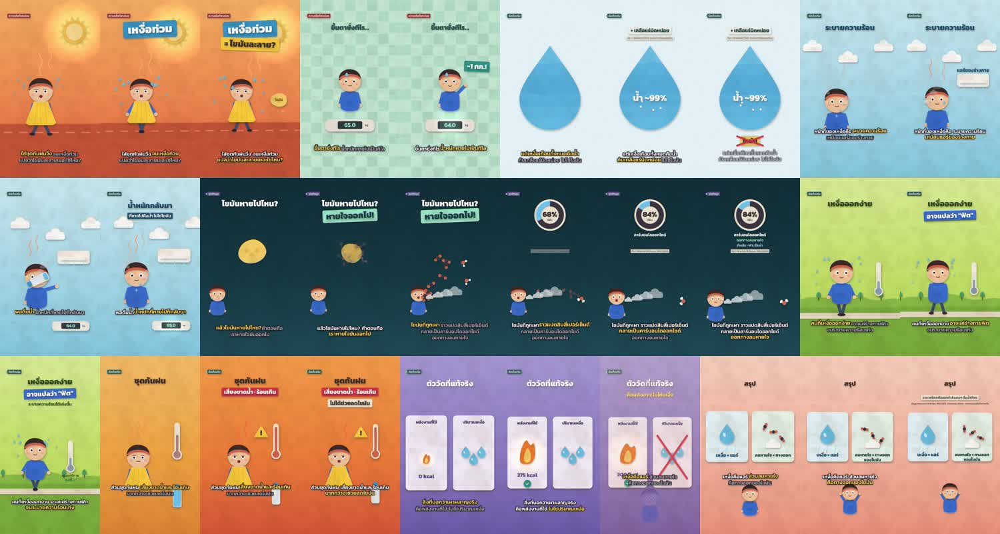

# QC Report — เหงื่อออกมากแปลว่าเผาผลาญไขมันมากจริงหรือ?

ไฟล์ที่ตรวจ: `out/shorts/sweat/sweat_shorts.mp4` (ไฟล์หลัก 36 MB) และ `sweat_shorts_720p.mp4` (5.4 MB สำหรับดูบนมือถือ)

## สเปก (ffprobe)

| รายการ | เป้าหมาย | ผล | สถานะ |
|---|---|---|---|
| ความยาว | 30–40 s | 39.40 s | ✅ |
| ความละเอียด | 1080×1920 (9:16) | 1080×1920, h264 yuv420p | ✅ |
| เฟรมเรต | 30 fps | 30/1, 1,182 เฟรม | ✅ |
| รูปแบบ | MP4 | MP4 (faststart), AAC 48 kHz stereo | ✅ |
| ความดัง | ประมาณ −14 LUFS | −14.2 LUFS, peak −2.6 dBFS (ไฟล์ 720p: −14.3 LUFS, −2.3 dBFS) | ✅ |

## ภาพ

| ตรวจ | วิธี | ผล |
|---|---|---|
| ส่วนสำคัญไม่หลุดเฟรม | contact sheet ทั้งเรื่องและเฟรมเต็มขนาด | ✅ แก้แล้ว 5 จุด: ซับทับตัวเลขบนตาชั่ง, ตัวละครถูกซับทับในฉากหักมุม, ป้าย "คาร์บอนไดออกไซด์" ล้นขอบขวา, ป้ายใต้เทอร์โมมิเตอร์ชนซับ, ก้อนไขมันใน Hook ดูเหมือนเหรียญ (เพิ่มป้าย "ไขมัน") |
| ไม่มีภาพกระตุกหรือ Animation ผิด | ดูเฟรมต่อเฟรมช่วงเปลี่ยนฉาก และวัดความต่างระหว่างเฟรมทั้ง 1,182 เฟรม | ✅ จุดที่ภาพเปลี่ยนแรงมีเพียงการซูมดำดิ่งเข้าหยดเหงื่อ (6.4–6.6 s) ซึ่งตั้งใจและเคลื่อนต่อเนื่องเมื่อดูทีละเฟรม และ dissolve เข้าฉากสีเข้ม (15.9 s) ไม่มีเฟรมดำ |
| แก้ข้อผิดพลาดของ Animation | ดูทีละเฟรม | ✅ แก้แล้ว 2 จุด: ตอนเริ่มซูม ภายในหยดเหงื่อโผล่เป็นวงกลมสีฟ้าทับหน้าตัวละคร (บั๊กการซ้อนความโปร่งใสใน `paper.js`), โมเลกุล CO₂ ไปกองกลางจอแทนที่จะออกไปกับลมหายใจ |
| ไม่มีช่วงว่าง | หาช่วงที่ภาพแทบไม่ขยับ | ✅ ช่วงนิ่งที่ยาวที่สุดคือ 1.0 s (ภายในหยดเหงื่อ ระหว่างที่ป้าย "น้ำ ~99%" ค้างให้อ่าน) |
| ตัวละครหรือวัตถุไม่เปลี่ยนรูป | ทุกชิ้นเป็นรูปทรงตายตัว | ✅ ก้อนไขมันแตกเป็นโมเลกุลโดยการหดตัวลงแล้วมีโมเลกุลแยกออกมา ซึ่งเป็นการเปลี่ยนที่ตั้งใจ ไม่ใช่การ morph |
| ความสม่ำเสมอ | contact sheet | ✅ ชุดเครื่องมือ Paper Cut และ grain เดียวกันทุกฉาก ตัวละครเหมือนกันทุกฉาก |

## เสียง

| ตรวจ | วิธี | ผล |
|---|---|---|
| บรรยายตรงบท ไม่มีคำซ้ำหรือคำขาด | `scripts/shorts_checkcuts.py` (ทุกบรรทัดเรียงคั่นด้วยช่วงเงียบ แล้วถอดเสียงทีละช่วง) | ✅ ทั้ง 11 บรรทัดตรงบท รอบแรกการตรวจนี้จับได้ว่าจุดตัด 2 จุดแรกผิด (ท้ายบรรทัด 1 ไปอยู่ในบรรทัด 2 และ "ไปเป็นกิโล" ไปอยู่ในบรรทัด 3) เพราะเวลาจากการถอดเสียงทั้งเทคคลาดไปราว 1.5 s แก้เป็นช่วงเงียบจริงที่ 4.25 s และ 6.90 s แล้วตรวจซ้ำผ่าน |
| เสียงบรรยายเหนือดนตรีและ SFX | เทียบพลังงานในย่านเสียงพูด | ✅ ทุกบรรทัดสูงกว่า 10.3–19.3 dB (เกณฑ์ ≥ 8 dB) |
| เสียงตรงกับภาพ | ภาพและ SFX อ่านเวลาวลีจาก `phrases.js` ชุดเดียวกัน | ✅ |
| ฟังด้วยหู | — | ⚠️ ยังไม่ได้ฟัง Claude ฟังเสียงไม่ได้ ควรมีคนฟังก่อนเผยแพร่ |

## เนื้อหา

| ตรวจ | ผล |
|---|---|
| แยกความเชื่อกับข้อเท็จจริง | ✅ ป้าย "ความเชื่อที่พบบ่อย" ใน Hook และ "ข้อเท็จจริง" / "จุดหักมุม" ในฉากที่อธิบาย |
| ตัวเลข | ✅ 99% (Cleveland Clinic) และ 84% (BMJ 2014) มีที่มากำกับบนจอ ตัวเลข kcal ในฉาก 7 เป็นภาพประกอบตัวนับ ไม่ใช่ข้อมูล |
| คำเตือนสุขภาพ | ✅ ชุดกันฝนเสี่ยงขาดน้ำและร้อนเกิน และท้ายคลิปบอกให้ดื่มน้ำให้พอ |
